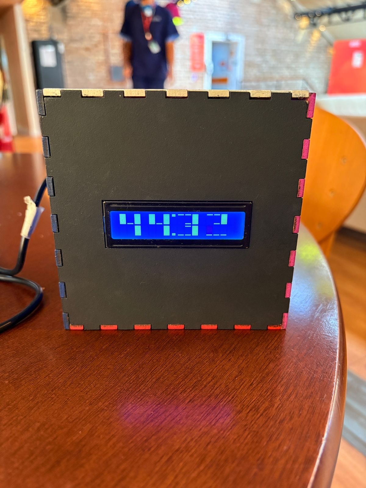

# Portfólio de Lizandra Vieira

**Engenheira de software · Android nativo e sistemas embarcados · Recife, PE**

Atuo no CESAR desenvolvendo e mantendo funcionalidades nativas para Android, em colaboração com a equipe de backend. Kotlin e Jetpack Compose estão entre as ferramentas que uso nessa área.

Comecei em sistemas embarcados, também atuei com iOS e macOS e estudo Ciência da Computação na CESAR School. Este portfólio reúne projetos que vão de protótipos físicos a plataformas web e análise de dados.

[**Ver portfólio online**](https://lizandra-vieira.vercel.app/) · [LinkedIn](https://www.linkedin.com/in/lizandra-vieira/) · [GitHub](https://github.com/lizandravieira)

## Em destaque · FocusCube

O FocusCube é um Pomodoro físico desenvolvido em equipe no CESAR School. Ao virar o cubo, um acelerômetro identifica a face que está para cima e inicia uma sessão de foco ou de pausa. O visor exibe a contagem regressiva e o firmware envia o estado do cronômetro a um painel web via MQTT.

**C++ · ESP32 · FreeRTOS · MQTT · I²C**



[Ver o código do firmware](https://github.com/lizandravieira/FocusCube) · [Assistir à demonstração na galeria](https://lizandra-vieira.vercel.app/#gallery)

## Outros projetos selecionados

| Projeto | O que explora | Tecnologias |
| --- | --- | --- |
| [Reconto](https://github.com/alecct812/reconto) | Logística reversa de eletrônicos em Recife, conectando consumidores, empresas e serviços públicos. | Java, Python |
| [ARCOS](https://github.com/lizandravieira/Arcos) | Plataforma personalizável para ONGs medirem e divulgarem o impacto de seus programas sociais. | HTML, CSS, Python |
| [HubFolio · Análise de dados](https://github.com/lizandravieira/AnaliseDeDados-HUBFolio) | Painel interativo sobre como estudantes e profissionais de tecnologia constroem e usam seus portfólios. | Python, Streamlit |
| [E-stuário](https://github.com/xjuveri/ProjetoE-stuario) | Protótipo de rede social local com feed, eventos e comunidades. | Python |

## Sobre o site

O portfólio é uma página responsiva em inglês, com filtros por categoria, navegação por seções e uma galeria com carrosséis e vídeo. Foi desenvolvido em **HTML, CSS e JavaScript**.

## Como abrir no computador

Na pasta do projeto, abra `index.html` no Chrome. A página funciona sem instalar dependências ou rodar um build. As fontes vêm do Google Fonts quando há conexão com a internet.

Para obter uma cópia em outro computador, use uma conta com acesso ao repositório privado e execute os comandos abaixo.

```bash
git clone https://github.com/lizandravieira/portfolio.git
cd portfolio
```

## Estrutura e manutenção

```text
portfolio/
├── index.html          # Conteúdo, seções e cartões dos projetos
├── styles.css          # Layout, tema e responsividade
├── script.js           # Filtros, carrosséis e navegação
└── assets/
    ├── hero-photo.png  # Foto de apresentação
    └── projects/       # Imagens e vídeo da galeria
```

Para acrescentar um projeto, adicione o cartão e uma entrada na galeria em `index.html` e salve as mídias em `assets/projects/`. Antes de salvar a atualização no Git, abra a página no Chrome e confira o filtro, a galeria e os links do novo projeto.

O `.gitignore` mantém `.env.local` e `.vercel/` fora do repositório.
